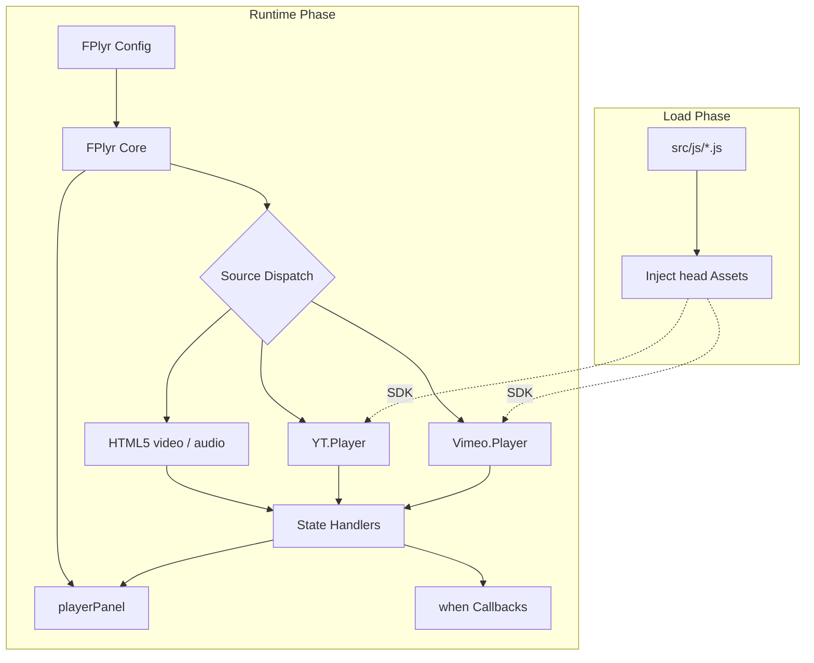

# Architecture

This page shows how FlexPlyr is layered and which way each layer depends on the next, in a single overview diagram.

## System Overview

## Layers

| Layer | File | Responsibility |
|-------|------|----------------|
| Bootstrap | `src/js/*.js` | Declares shared constants, detects `isMobile`/`isIOS`, and injects the stylesheet, icon font, and YouTube and Vimeo SDKs into `<head>` |
| Core | `src/js/model/player.js` | The `FPlyr` class: merges config, builds the container, initializes the source, and exposes one method set for all four sources |
| Control panel | `src/js/model/playerPanel.js` | Builds controls from `panelItem` and exposes update hooks such as `setCurrent`, `setVolume`, and `show`/`hide` |
| Helpers | `src/js/function/*.js` | `createElement` (builds elements from `tag#id.class`), `UUID` (YouTube container IDs), `getTime` (time formatting) |

The bootstrap file is literally named `*.js`, and the `terser` build globs (`src/js/*.js src/js/**/*.js`) concatenate it with every other source file into `dist/`. The `FPlyr` and `playerPanel` classes live in `src/js/model`. `src/js/model/videoPlayer.js` is bundled into `dist/`, but nothing references it.

## Cross-Cutting Principles

- **Source differences live only in the core**: every operation (play, seek, volume, speed) branches on `#isVideo`/`#isAudio`/`#isYoutube`/`#isVimeo`, so the panel and `when` callbacks never need to know the source type.
- **State is event-driven**: panel icons and progress update only from source events (`playing`, `pause`, `ended`) and a 100 ms poll, never directly from button clicks.
- **Mobile fullscreen uses a second player**: see [Mobile Fullscreen](/mobile-fullscreen).

## Further Reading

Per-module diagrams, sequence diagrams, and the state machine live in [doc/architecture.md](https://github.com/pardnchiu/FlexPlyr/blob/main/doc/architecture.md).
