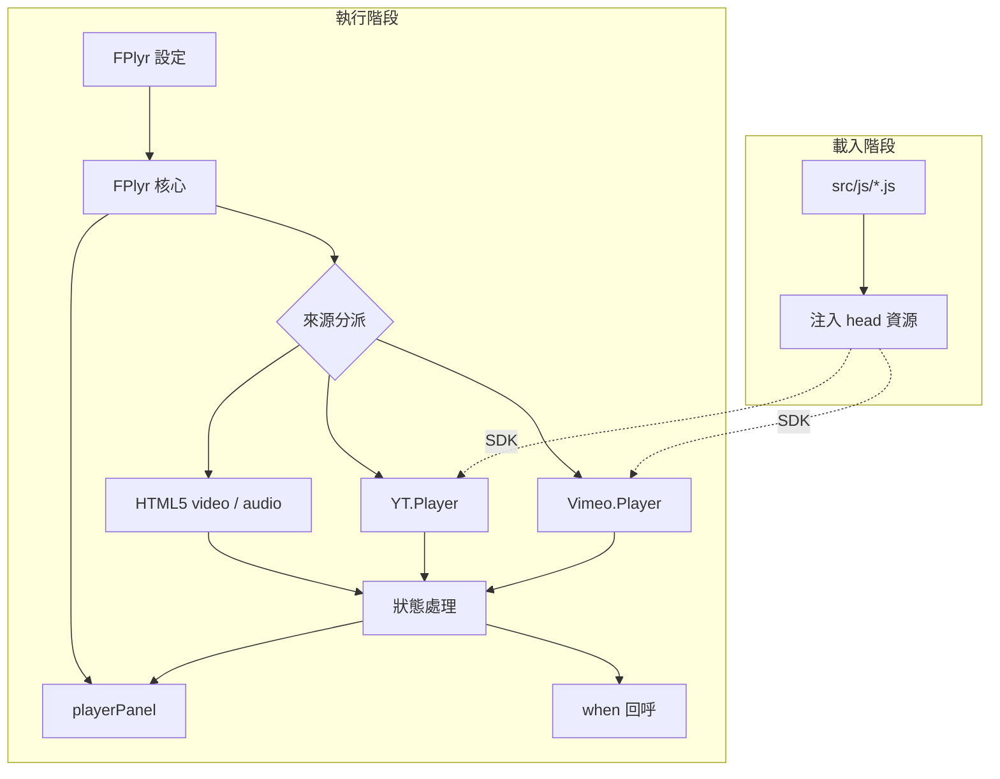

# 架構

本頁以一張概覽圖說明 FlexPlyr 的分層，以及各層之間的依賴方向。

## 系統概覽

## 分層

| 層 | 檔案 | 職責 |
|----|------|------|
| 載入引導 | `src/js/*.js` | 宣告共用常數、偵測 `isMobile`／`isIOS`，並把樣式、圖示字型、YouTube 與 Vimeo SDK 注入 `<head>` |
| 核心 | `src/js/model/player.js` | `FPlyr` 類別：合併設定、建立容器、依來源初始化、把四種來源的操作統一成同一組方法 |
| 控制面板 | `src/js/model/playerPanel.js` | 依 `panelItem` 建立控制元件，提供 `setCurrent`、`setVolume`、`show`／`hide` 等更新介面 |
| 輔助函式 | `src/js/function/*.js` | `createElement`（以 `tag#id.class` 建立元素）、`UUID`（YouTube 容器 ID）、`getTime`（時間格式化） |

載入引導檔的檔名就是 `*.js`，`terser` 建置指令的 glob（`src/js/*.js src/js/**/*.js`）會把它與其餘原始檔一起串接打包進 `dist/`。`FPlyr` 與 `playerPanel` 類別位於 `src/js/model`。`src/js/model/videoPlayer.js` 會被打包進 `dist/`，但沒有任何程式引用它。

## 跨層原則

- **來源差異只存在於核心**：每個操作（播放、跳轉、音量、倍速）都以 `#isVideo`／`#isAudio`／`#isYoutube`／`#isVimeo` 分流，面板與 `when` 回呼不需要知道來源類型。
- **狀態由事件驅動**：面板圖示與進度只在來源事件（`playing`、`pause`、`ended`）與 100ms 輪詢中更新，不由按鈕點擊直接寫入。
- **行動裝置以第二個播放器處理全螢幕**：見[行動裝置全螢幕](/zh/mobile-fullscreen)。

## 延伸閱讀

模組級的詳細圖、序列圖與狀態機在 [doc/architecture.zh.md](https://github.com/pardnchiu/FlexPlyr/blob/main/doc/architecture.zh.md)。
